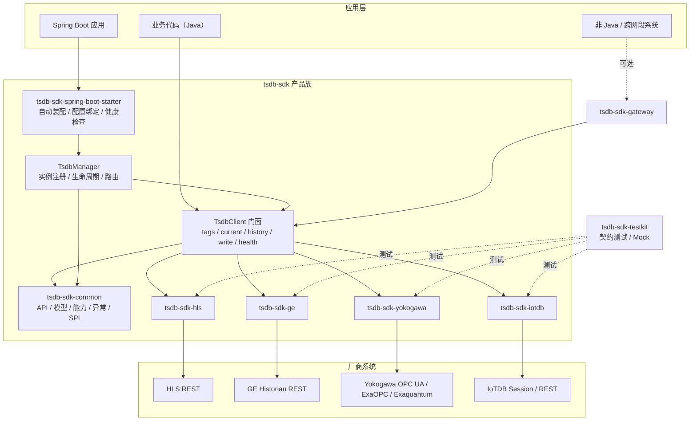
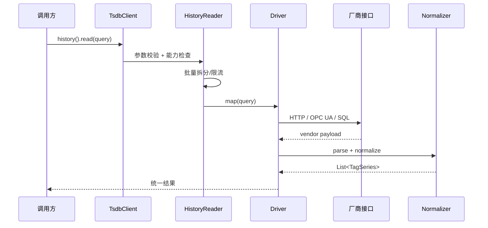
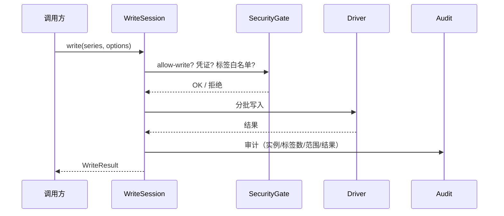

# 03 总体架构与模块设计

> ⚠️ 范围变更（2026-11-09）：横河已移出本期范围，新增力控 pSpace；运行态改为“单活动实例 + 策略切换”。本文横河模块/OPC UA 章节为历史设计；冲突时以 [`docs/06-范围变更与力控接入.md`](06-范围变更与力控接入.md) 为准。

> 文档版本：v1.0（2026-11-09）  
> 目标：定义一套可落地、可扩展、可安全交付的多库 SDK 架构。  
> 关联：`docs/01`（需求）、`docs/04`（API 规范）、`docs/05`（路线图）

---

## 1. 设计原则

| 编号 | 原则 | 含义 | 反例（禁止） |
|---|---|---|---|
| P1 | **公共层零厂商依赖** | `tsdb-sdk-common` 只依赖 JDK + Hutool + fastjson + SLF4J | common 里 import GE/HLS/IoTDB 的厂商类 |
| P2 | **一库一模块** | 每个库独立 Maven 模块、独立包、独立依赖 | 所有库塞进一个 jar |
| P3 | **能力优先于统一** | 先声明能力，再提供接口；不支持就明确报错 | 大接口 + `UnsupportedOperationException` |
| P4 | **实例化，去静态** | 每实例独立配置、Token、缓存、线程池 | `private static ApiConfig config` |
| P5 | **原生逃生口** | 公共接口之外必须能拿到厂商原生对象 | 为了“统一”阉割厂商能力 |
| P6 | **失败快、错误清** | 超时必设、错误分类、保留厂商码 | 无限等待、吞异常 |
| P7 | **默认安全** | 只读、TLS 校验、密钥外置、写审计 | 默认 trust-all、密码写 YAML |
| P8 | **契约可测** | 同一套用例验证所有驱动 | 每个驱动各写各的测试 |

---

## 2. 总体架构



**分层说明**：

1. **应用层**：只依赖 `common` 的接口与模型，不依赖具体驱动。
2. **门面层**：`TsdbClient` 暴露领域接口；`TsdbManager` 管理多实例。
3. **公共层**：模型、能力、异常、配置、SPI；不含任何 HTTP/厂商实现。
4. **驱动层**：每库实现 SPI，负责协议、认证、映射、归一。
5. **厂商层**：真实服务；测试时用 Mock 替代。
6. **测试层**：契约测试保证“换库不换语义”。

---

## 3. 模块划分

| 模块（artifactId） | 职责 | 依赖 | 是否对外 |
|---|---|---|---|
| `tsdb-sdk-parent` | 父 POM：版本、插件、编码、许可证 | — | 否 |
| `tsdb-sdk-bom` | 依赖管理，统一版本 | — | 是 |
| `tsdb-sdk-common` | 公共 API、模型、能力、异常、配置、SPI、工具 | JDK8、Hutool、fastjson、SLF4J | 是 |
| `tsdb-sdk-hls` | HLS 驱动：REST、Token、宽表拆分 | common、HTTP 客户端 | 是 |
| `tsdb-sdk-ge` | GE 驱动：REST、OAuth、长表解析 | common、HTTP 客户端 | 是 |
| `tsdb-sdk-yokogawa`（未实现） | 横河驱动：OPC UA（DA/HDA）、ExaOPC、Exaquantum | common、Eclipse Milo（可选） | 是 |
| `tsdb-sdk-iotdb` | IoTDB 驱动：NATIVE（SessionPool）/ JDBC / REST 三通道 | common、iotdb-session、iotdb-jdbc | 是 |
| `tsdb-sdk-spring-boot-starter` | 自动装配、`@ConfigurationProperties`、Actuator | common + 所有驱动（optional） | 是 |
| `tsdb-sdk-testkit`（未实现） | 契约测试基类、Mock Server、断言工具 | common、JUnit5、WireMock | 是（test scope） |
| `tsdb-sdk-samples`（未实现） | 可运行示例 | starter + 驱动 | 否 |
| `tsdb-sdk-gateway`（P4，未实现） | REST 网关 | starter | 可选 |

### 3.1 依赖规则（用 Maven Enforcer 固化）

```
common        → 只允许 JDK / Hutool / fastjson / SLF4J / JUnit(test)
hls           → common + HTTP 客户端（不得依赖 ge/yokogawa/iotdb）
ge            → common + HTTP 客户端（不得依赖 hls/...）
yokogawa      → common + Milo/OPC UA 客户端
iotdb         → common + iotdb-session + iotdb-jdbc
starter       → common + 各驱动（optional=true）
samples       → starter + 需要的驱动
```

**禁止**：
- 驱动之间互相依赖；
- common 依赖 Spring（可选 `spring-context` 仅用于注解？不，保持纯 Java）；
- common 依赖厂商驱动类或 Jackson 等已移除的实现库；
- starter 强制拉入所有驱动（用 optional + `@ConditionalOnClass`）。

### 3.2 版本策略

- 所有模块同一版本号（reactor 统一），由 `parent` 管理；
- 驱动可独立发版，但 1.x 内保持 SPI 兼容；
- `tsdb-sdk-bom` 锁定第三方版本（Hutool、fastjson、Milo、iotdb-session）。

---

## 4. 代码结构（现行实测）

> 本节是**现行结构**，按 2026-11-16 的 `find tsdb-sdk-*/src/*/java -name '*.java'` 实测绘制：
> 主代码 **127 个类 + 25 个 `package-info.java`**（152 个文件、25 个包），测试 **32 个类**。
> 下面括号内的数字是**类数，不含 `package-info.java`**；每个包都有 `package-info.java`，
> 写明职责、可见性契约与「改什么找哪个类」。规划中但**未实现**的模块与类名见 §4.3，
> 不要照着它们找代码。力控模块的现行设计见
> [`docs/06-范围变更与力控接入.md`](06-范围变更与力控接入.md)。

### 4.1 包地图

```
tsdb_sdk/
├── pom.xml                                        # parent
├── tsdb-sdk-bom/pom.xml
│
├── tsdb-sdk-common/src/main/java/io/github/forget_the_bright/tsdb/common/
│   ├── (2)              TsdbClients TsdbManager
│   ├── api/       (7)   TsdbClient TagCatalog CurrentValueReader HistoryReader
│   │                    DeltaReader WriteSession HealthCheck
│   ├── model/     (21)  刻意平铺，分类索引见该包 package-info
│   │                    枚举 8：Quality ValueType Aggregation QueryMode
│   │                            TimeGranularity Direction FillPolicy Capability
│   │                    查询 2：HistoryQuery TagQuery
│   │                    结果 8：Sample TagSample TagSeries TagInfo DeltaPoint
│   │                            DeltaSeries HealthStatus CapabilitySet
│   │                    写入 2：WriteRequest WriteResult
│   ├── config/    (8)   TsdbConfig TsdbConfigLoader TsdbInstanceConfig AuthConfig
│   │                    SecurityConfig TimeConfig TimeoutConfig RetryConfig
│   ├── exception/ (9)   TsdbException TsdbErrorCode + 7 个具体异常
│   │                    （Configuration/Connection/Authentication/Timeout/
│   │                      Unsupported/Query/Data）
│   ├── spi/       (3)   TsdbDriver DriverContext Metrics
│   └── internal/  (1)   Texts                       # 以下均不承诺兼容
│       ├── http/  (5)   HttpTransport HttpResult HttpErrors BasicAuth TrustAllSsl
│       └── json/  (2)   Json JsonText
│
├── tsdb-sdk-ge/src/main/java/io/github/forget_the_bright/tsdb/ge/
│   ├── (4)              GeClient GeConfig GeDriver GeMapper        # 公共入口
│   ├── internal/  (4)   GeNativeApi GeHttpClient GeTokenManager GeModels
│   │   └── adapter/ (5) GeSupport GeTagCatalogAdapter GeCurrentValueAdapter
│   │                    GeHistoryAdapter GeDeltaAdapter
│   └── nativeapi/ (1)   GeEndpoint                  # 92 个端点的枚举目录
│
├── tsdb-sdk-hls/src/main/java/io/github/forget_the_bright/tsdb/hls/
│   ├── (4)              HlsClient HlsConfig HlsDriver HlsMapper
│   ├── internal/  (4)   HlsNativeApi HlsHttpClient HlsTokenManager HlsModels
│   │   └── adapter/ (6) HlsSupport HlsTagCatalogAdapter HlsCurrentValueAdapter
│   │                    HlsHistoryAdapter HlsDeltaAdapter HlsWriteAdapter
│   └── nativeapi/ (0)   命名空间，本包无类
│       └── dto/   (3)   HistorianRequest TagNameListRequest TagNameRequest
│
├── tsdb-sdk-iotdb/src/main/java/io/github/forget_the_bright/tsdb/iotdb/
│   ├── (5)              IotdbClient IotdbConfig IotdbDriver IotdbMapper
│   │                    IotdbTransport
│   └── internal/  (1)   IotdbModels                 # 跨子包共享的厂商 DTO 换算
│       ├── adapter/   (7)  IotdbSupport IotdbSeriesAssembler
│       │                   IotdbTagCatalogAdapter IotdbCurrentValueAdapter
│       │                   IotdbHistoryAdapter IotdbDeltaAdapter IotdbWriteAdapter
│       ├── sql/       (5)  IotdbTagPath IotdbTagResolver TagPathMapper
│       │                   Grouping IotdbSql
│       ├── query/     (11) IotdbQueryService IotdbQueryCore
│       │                   IotdbCurrentQueries IotdbRawQueries IotdbSampledQueries
│       │                   IotdbAggregationQueries IotdbInterpolationQueries
│       │                   IotdbDeltaQueries PointMath ResultColumns SeriesKeyIndex
│       └── transport/ (7)  IotdbQueryExecutor IotdbNativeQueryExecutor
│                           IotdbJdbcQueryExecutor IotdbRestQueryExecutor
│                           IotdbRestApi IotdbHttpClient IotdbResultTable
│
└── tsdb-sdk-spring-boot-starter/src/main/java/io/github/forget_the_bright/tsdb/spring/
    └── (2)              TsdbAutoConfiguration TsdbProperties
```

测试镜像（32 个类，包路径与主代码一致，另加各驱动的 `it` 门控集成测试包）：

```
common (13)  TsdbManagerTest；api/ DeltaReaderIntervalTest；
             config/ TimeConfigTest TsdbInstanceConfigTest；
             model/ HistorianUnitTest HistoryQueryTest SampleTimeFieldsTest TagSampleTest；
             internal/ TextsTest；internal/http/ BasicAuthTest HttpErrorsTest
             HttpTransportTest；internal/json/ JsonTextTest
ge     (3)   GeClientTest；it/ GeProductionIT GeComparisonIT
hls    (2)   HlsClientTest；it/ HlsProductionIT
iotdb  (13)  IotdbClientTest IotdbConfigTest；
             internal/sql/ GroupingTest IotdbSqlTest IotdbTagPathTest IotdbTagResolverTest；
             internal/query/ IotdbQueryServiceTest SeriesKeyIndexTest；
             internal/transport/ IotdbRestQueryExecutorTest；
             it/ IotdbProductionIT IotdbMappingProductionIT IotdbContractProbeIT
                 IotdbTierParityIT
spring (1)   TsdbAutoConfigurationTest
```

### 4.2 包名规则与可见性契约

- **公共 API**：`io.github.forget_the_bright.tsdb.common.api`；
- **公共模型**：`io.github.forget_the_bright.tsdb.common.model`（平铺，靠 package-info 分类索引）；
- **驱动入口**：`io.github.forget_the_bright.tsdb.<vendor>`，只放 `Client`/`Config`/`Driver`/`Mapper`
  与驱动枚举（IoTDB 另有 `IotdbTransport`）。宿主应用的 import 只应落在这一层与 `common.api`/`common.model`；
- **门户装配层**：`<vendor>.internal.adapter`＝适配器 + 共享 `Support`（IoTDB 另含 `IotdbSeriesAssembler`）。
  这些类是 `public`，**但只是为了让根包门户能构造它们，不是公共 API**；类 Javadoc 与 package-info
  都写明「签名随内部重构变化，宿主应用请勿直接依赖」；
- **实现职责包**：`<vendor>.internal.<职责>`，**不承诺兼容**。IoTDB 已按职责三分
  （`sql`/`query`/`transport`）；GE/HLS 目前只有 `internal` 根包 + `adapter`，类数少，不预建碎片包；
- **原生逃生层**：`<vendor>.nativeapi`（GE 是端点枚举，HLS 是请求 DTO），经 `unwrap(...)` 取用，
  能力不裁剪；
- **共享工具**：`common.internal`（文本）、`common.internal.http`、`common.internal.json`，不承诺兼容；
- **示例**（未实现）：`io.github.forget_the_bright.tsdb.samples`。

两条必须知道的可见性事实：

1. **Java 没有 `internal` 可见性**。编译器能强制的隐藏只有「包私有 + 同包」。因此
   `iotdb.internal.query` 里 9 个包私有类（`IotdbQueryCore`、6 个 `*Queries`、`PointMath`、
   `ResultColumns`）**必须整簇同包**，拆散即编译失败；而装配层类下沉子包只能改 `public`，
   靠 Javadoc/package-info/本文档三处声明约束，而不是靠编译器。
2. **根包 ↔ `internal.adapter` 是双向引用**：门户构造适配器，适配器读根包 `Config`/`Mapper`。
   这是门面模式的固有形状，**jar/模块级依赖仍然无环**（驱动之间不互相依赖，common 不依赖驱动）。
   子包之间的方向是 `adapter → query → sql / transport`，四者都可依赖 `internal.IotdbModels`。

新增驱动必须照这套布局落地，强制模板见
[`docs/07-新增驱动接入指南.md`](07-新增驱动接入指南.md) 的「包布局约定」。

### 4.3 规划中，未实现

以下模块在历史设计里出现过，**当前仓库没有对应目录**，不要按它们找代码：

| 模块 | 状态 |
|---|---|
| `tsdb-sdk-yokogawa`（OPC UA / ExaOPC / Exaquantum） | 未实现；横河/力控范围变更见 `docs/06` |
| `tsdb-sdk-testkit`（契约测试基类、Mock Server） | 未实现；契约探针目前落在各驱动 `it` 包 |
| `tsdb-sdk-samples` | 未实现 |
| `tsdb-sdk-gateway`（P4 REST 网关） | 未实现 |

历史设计里的这些**类名/包名从未落地或已改名**，读旧文档时请对照：

- `common/internal/` 的 `AbstractTsdbClient`、`RetryExecutor`、`CircuitBreaker`、`Bulkhead`、
  `TagCache`、`SecretResolver`、`ThreadPools`、通用 `TokenManager`：**都没有实现**。
  重试/熔断/舱壁/缓存目前不存在；`retry.max-attempts`/`retry.backoff-millis` 只保留配置语义
  （IoTDB 侧读成 `getMaxReadAttempts()`/`getRetryBackoffMillis()`），传输层不执行重试
  （见 `IotdbConfig` Javadoc）。Token 管理是各驱动自己的 `GeTokenManager`/`HlsTokenManager`。
- `common/capability/`：并入 `common/model/`（`Capability`、`CapabilitySet`）。
- `common/spi/DriverDescriptor`、`NativeApi`：未实现；`Metrics` 在 `common.spi`，不在 `internal`。
- `common/config/TsdbProperties`、`TlsConfig`：Spring 绑定类实际是 `spring/TsdbProperties`；
  `tls.verify-hostname` 等选项落在 `SecurityConfig`，没有独立的 `TlsConfig` 类。
- `hls/HlsCapabilities`、`HlsRequestFactory`、`HlsResponseParser`、`HlsModelMapper`、`HlsApiClient`：
  实际对应 `HlsClient` 的能力声明、`nativeapi/dto/HistorianRequest`、`internal/HlsModels`、
  `internal/HlsHttpClient`。
- `iotdb/IotdbNativeApi`、`iotdb/session/`、`iotdb/rest/`：实际是
  `internal/transport/IotdbRestApi` 与三个 `*QueryExecutor`（NATIVE/JDBC/REST 三通道，默认 REST）。
- `starter/TsdbPropertiesBinder`、`TsdbHealthIndicator`、`TsdbMetricsBinder`：未实现；
  自动装配只有 `TsdbAutoConfiguration` + `TsdbProperties`，包名是 `spring` 而不是 `starter`。

---

## 5. 运行时模型

### 5.1 对象关系

```
TsdbManager (1)
   ├── Map<String, TsdbClient> instances
   ├── TsdbProperties
   └── DriverRegistry
          │
          ▼
TsdbClient (N)
   ├── instanceName / type / capabilities
   ├── TagCatalog
   ├── CurrentValueReader
   ├── HistoryReader
   ├── WriteSession (lazy)
   ├── HealthCheck
   ├── DriverContext
   │     ├── config
   │     ├── Json (fastjson 全局配置：AutoType 关闭、safeMode)
   │     ├── ExecutorService (bounded)
   │     ├── ScheduledExecutor (token refresh)
   │     ├── Metrics (SDK 内部接口，Micrometer 适配在 starter)
   │     ├── SecretResolver
   │     └── Clock
   └── NativeApi (vendor object)
```

### 5.2 生命周期

```
NEW → STARTING → READY ⇄ DEGRADED → CLOSING → CLOSED
```

- `STARTING`：解析配置、构造客户端、首次认证（可配置懒加载）；
- `READY`：可用；
- `DEGRADED`：最近一次健康检查失败，但仍可尝试请求；
- `CLOSED`：释放线程池、连接、缓存；`close()` 幂等。

**规则**：
- 构造失败不注册到 Manager，启动时快速失败（可配置 `fail-fast=false` 跳过坏实例）；
- 关闭顺序：停止接收新请求 → 等待在途（默认 5s）→ 关闭连接 → 关闭线程池；
- 每个实例的线程池命名 `tsdb-<instance>-io`，便于排障。

### 5.3 线程模型

- I/O 使用有界线程池（默认 `max(4, CPU*2)`），禁止 `Executors.newCachedThreadPool()`；
- 每实例一个 `Semaphore`（默认 8 并发）做 bulkhead；
- Token 刷新用单线程调度器 + 单飞锁，不占用 I/O 线程；
- 回调/监听器在独立线程执行，异常只记日志，不影响主流程。

---

## 6. 驱动 SPI

### 6.1 接口

```java
package io.github.forget_the_bright.tsdb.common.spi;

public interface TsdbDriver {
    /** 唯一类型标识，如 "hls"、"ge"、"yokogawa"、"iotdb" */
    String type();

    /** 静态能力声明；运行时可进一步探测 */
    Set<Capability> capabilities();

    /** 配置校验；默认空实现，失败抛 TsdbConfigurationException */
    default void validate(TsdbInstanceConfig config) {
    }

    /** 连接后能力探测；默认返回静态声明 */
    default Set<Capability> probe(DriverContext context) {
        return capabilities();
    }

    /** 创建客户端；实现方负责校验配置 */
    TsdbClient create(TsdbInstanceConfig config, DriverContext context);

    /** 供文档/诊断使用 */
    default DriverDescriptor descriptor() {
        return DriverDescriptor.of(type(), capabilities());
    }
}
```

### 6.2 注册方式

1. **ServiceLoader**（纯 Java）：
   `META-INF/services/io.github.forget_the_bright.tsdb.common.spi.TsdbDriver`
2. **Spring**：starter 扫描 `TsdbDriver` 实现并注册为 Bean；
3. **手动**：`TsdbClients.builder().driver(new HlsDriver())`。

### 6.3 配置校验

每个驱动实现 `validate(TsdbInstanceConfig)`，失败抛 `TsdbConfigurationException`，消息包含：
`instance=hls_main, field=hls.base-url, reason=must not be blank`。

**原则**：启动时校验 > 首次调用时报错。

---

## 7. 配置模型

### 7.1 统一前缀

```yaml
tsdb:
  default-instance: hls_main
  fail-fast: true
  security:
    allow-write: false
    allow-insecure-transport: true   # 仅因参照 HLS 环境为 http；生产改 false 并上 TLS
    tls:
      verify-hostname: true
    audit:
      enabled: true
  instances:
    hls_main:
      type: hls
      enabled: true
      base-url: http://10.10.7.177:9000   # 参照工程为 http；生产建议前置 TLS 代理
      auth:
        mode: header-token
        user-id: ${HLS_USER}
        secret-key: ${HLS_SECRET}
      timeout:
        connect: 5s
        read: 30s
      pool:
        max-concurrent: 8
      cache:
        tag-ttl: 10m
        token-skew: 60s
    ge_main:
      type: ge
      base-url: https://172.16.176.9
      auth:
        mode: oauth2
        client-id: ${GE_CLIENT_ID}
        client-secret: ${GE_CLIENT_SECRET}
        username: ${GE_USER}
        password: ${GE_PASSWORD}
      timeout:
        connect: 5s
        read: 60s
    yokogawa_dcs:
      type: yokogawa
      protocol: opcua
      endpoint: opc.tcp://10.20.30.40:4840
      auth:
        mode: x509
        certificate: ${YOKO_CERT}
        private-key: ${YOKO_KEY}
      options:
        security-policy: Basic256Sha256
        security-mode: SignAndEncrypt
        namespace-uri: "urn:yokogawa:centum"
        browse-root: "ns=2;s=..."
    iotdb_historian:
      type: iotdb
      protocol: session
      node-urls:
        - 10.30.1.10:6667
        - 10.30.1.11:6667
      auth:
        mode: password
        username: ${IOTDB_USER}
        password: ${IOTDB_PASSWORD}
      options:
        database: root.tongling
        fetch-size: 10000
        max-session-pool-size: 16
```

### 7.2 公共字段

> `common.config` 下全部为不依赖 Spring 的纯 POJO；`@ConfigurationProperties` 绑定与校验在 starter 的 `TsdbPropertiesBinder` 中完成，避免 common 引入 Spring 依赖。

| 字段 | 类型 | 默认 | 说明 |
|---|---|---|---|
| `type` | string | 必填 | 驱动类型 |
| `enabled` | bool | true | 是否装配 |
| `base-url` / `endpoint` / `node-urls` | string/list | — | 连接地址 |
| `auth.mode` | enum | 必填 | `header-token`/`oauth2`/`basic`/`x509`/`password` |
| `timeout.connect` | Duration | 5s | 连接超时，禁止 0/-1 |
| `timeout.read` | Duration | 30s | 读取超时 |
| `timeout.write` | Duration | 30s | 写入超时 |
| `retry.max-attempts` | int | 2 | 仅幂等读 |
| `retry.backoff` | Duration | 200ms | 指数退避基数 |
| `pool.max-concurrent` | int | 8 | 每实例并发上限 |
| `cache.tag-ttl` | Duration | 10m | 标签目录缓存 |
| `cache.token-skew` | Duration | 60s | Token 提前刷新 |
| `options` | map | — | 驱动专属，驱动校验 |

#### 7.2.1 时间格式选项

`options.time.*` 由公共 `TimeConfig` 解释，属于驱动无关的公共能力。GE、HLS、IoTDB
均已接入 `timeConfig()` 与 `parseTimestamp`/`formatTimestamp`；其中 GE 的协议时间实际走
文本格式化/解析，HLS/IoTDB 的协议字段是 epoch，不消费 `request.*`，但保留同一套配置与
展示能力，力控接入时直接复用：

- `request.enabled/zone/pattern`：请求时把 `Instant` 转成厂商字符串；
- `response.enabled/source-zone`：响应无时区文本按哪个时区解释；
- `response.target-zone/pattern`：展示时输出到哪个时区、哪种格式。

默认全部 UTC，不假设东八区。铜陵 GE 现场配 `request.zone: UTC`、
`response.source-zone: UTC`、`response.target-zone: GMT+8`，实现“UTC 进出、
北京时间展示”；若某项目 GE 本身用 GMT+8，只改前两项即可。公共模型的
`Sample.timestamp` 始终是绝对 `Instant`，时区不进入时间值。返回对象同时带
`timestampDate`（`java.util.Date`）与 `timestampText`（按上述配置格式化），
前端直接展示 `timestampText` 即可；健康检查的 `checkedAtDate/checkedAtText` 同理。

### 7.3 旧配置兼容（规划，当前版本未实现）

- 若 `tsdb.instances` 为空，且存在 `hls.datacollection.base-url`，自动合成 `hls_default` 实例；
- 同理 `ge.datacollection.base-url`；
- 旧字段映射表写入 `docs/04`；
- 旧前缀与新前缀同时存在时，**新前缀优先**，启动日志提示。

### 7.4 配置优先级

```
命令行/环境变量 > application-{profile}.yml > application.yml > 默认值
```

密钥只从环境变量/密钥文件读取，**不允许**出现在版本库 YAML 中（示例用占位符）。

---

## 8. 原生 API 设计

### 8.1 目标

- 公共接口覆盖 80% 通用场景；
- 剩下 20% 厂商特有能力（GE 报警/采集器、HLS 原始请求、OPC UA 订阅、IoTDB SQL）通过原生 API 使用；
- 原生 API 不进公共模型，不保证跨库一致。

### 8.2 形式

```java
// 实现形态：具体类（不是接口），实例化后由 client.unwrap(...) 取得
public final class HlsNativeApi {
    // 与旧 HLSApiInvoker 签名对齐，但不再 static
    public JSONObject queryAllTags();
    public JSONObject getDDBTagValue(TagNameListRequest request);
    public JSONObject getHDBTagValue(HistorianRequest request);
    // Bound/Max/Min/Avg/All 的 String... 与 Collection<String> 重载
}

public final class GeNativeApi {
    // 92 个端点目录 + 通用执行器；不再为每个端点写一个 Java 方法
    public Object invoke(GeEndpoint endpoint, Map<String,Object> pathVars,
                         Map<String,Object> queryParams, Object body);
    public Object rawRequest(String method, String relativePath, Object body);
}

public final class IotdbRestApi {
    public JSONObject query(String sql);
    public JSONObject nonQuery(String sql);
    public JSONObject insertTablet(JSONObject request);
    public String ping();
}
```

> 早期设计曾把原生 API 定义为 `NativeApi` 接口、按域拆 `data()/tags()/...`，并在 IoTDB 暴露 `SessionPool`。实现时改为具体类：HLS 保留原方法名与全部重载；GE 用端点目录 + `invoke` 覆盖 92 个端点，避免 92 个重复包装；IoTDB 直接暴露 REST SQL，避免把 `iotdb-session` 依赖强加给调用方。

### 8.3 使用

```java
GeNativeApi nativeApi = client.unwrap(GeNativeApi.class);
Object tags = nativeApi.invoke(GeEndpoint.QUERY_TAGS_BY_PARAMS,
        java.util.Collections.singletonMap("maxNumber", 100));
```

**规则**：
- `unwrap` 不支持的类型抛 `TsdbUnsupportedException`；
- 原生调用绕过能力校验/质量归一/审计（写操作仍受 `allow-write` 门禁？**不**，原生调用由调用方负责；文档必须警示）；
- 原生对象生命周期归 client 所有，client 关闭后不可用。

> 设计取舍：不在原生 API 外面再包一层“安全代理”，因为那会破坏“原生”的语义；安全靠配置、网络分区、只读账号与代码评审。

---

## 9. 能力协商

### 9.1 能力枚举

```java
public enum Capability {
    TAG_BROWSE,
    TAG_SEARCH,
    TAG_CRUD,
    CURRENT_VALUE,
    RAW_HISTORY,
    AGGREGATED_HISTORY,
    INTERPOLATED_HISTORY,
    SAMPLED_HISTORY,
    TREND,
    WRITE,
    DELETE,
    ALARM,
    SUBSCRIPTION,
    SYSTEM_ADMIN
}
```

### 9.2 声明与探测

- 驱动 `capabilities()` 返回静态集合；
- 连接后可 `probe()` 细化（例如 OPC UA 是否支持 HDA）；
- `CapabilitySet` 不可变，`refresh()` 生成新快照；
- 文档/健康检查展示当前能力。

### 9.3 失败语义

```java
throw new TsdbUnsupportedException(
    TsdbErrorCode.UNSUPPORTED,
    "instance=hls_main, type=hls, capability=RAW_HISTORY, " +
    "reason=HLS only supports aggregated history"
);
```

**禁止**：静默返回空列表伪装成功。

---

## 10. 关键数据流

### 10.1 读历史



**要点**：
- 校验在发请求前：时间范围、标签数、间隔、点数上限；
- 批量按驱动上限拆分（HLS/GE 单次标签数限制不同）；
- 失败时返回已成功部分？**默认整体失败**，除非 query 开启 `partialResultAllowed`；
- 结果顺序与请求标签顺序一致（或提供 map），文档写明。

### 10.2 写



### 10.3 标签目录

- 首次读厂商 → 归一 → 缓存（TTL）；
- 大目录分页/分批，避免一次性加载；
- 断网时可返回过期缓存，标记 `stale=true`；
- 缓存 key 含实例名，避免多库串味。

---

## 11. 错误模型

### 11.1 异常层次

```
TsdbException (RuntimeException)
├── TsdbConfigurationException    配置缺失/非法
├── TsdbConnectionException       连接失败/断线
├── TsdbAuthenticationException   401/403/证书失败
├── TsdbTimeoutException          超时
├── TsdbUnsupportedException      能力不支持
├── TsdbQueryException            厂商返回错误/语法错误
└── TsdbDataException             解析/类型/质量异常
```

### 11.2 字段

| 字段 | 说明 |
|---|---|
| `code` | 统一错误码，如 `TSDB-AUTH`；HTTP 401 放 `vendorCode` |
| `instance` | 实例名 |
| `type` | 驱动类型 |
| `operation` | `readCurrent`/`readHistory`/`write`/`listTags` |
| `vendorCode` | 厂商原始码/HTTP 状态 |
| `retryable` | 是否可重试 |
| `cause` | 原始异常 |

### 11.3 重试判定

| 情况 | 重试 |
|---|---|
| 连接超时/读超时 | ✅（幂等读） |
| HTTP 429/503 | ✅（带退避） |
| HTTP 401/403 | ❌（先刷新 token，再重试一次） |
| HTTP 400/404 | ❌ |
| 业务码“标签不存在” | ❌ |
| 写入 | ❌（除非幂等键明确） |

---

## 12. 可用性设计

> **实现状态（2026-11-16 实测）**：本节是设计口径，不等于现状。
> 已实现：超时（`TimeoutConfig` + 各驱动传输层）、Token 管理（`GeTokenManager`/`HlsTokenManager`，
> `volatile` + `synchronized` 二次检查单飞、提前 5 秒失效）、健康检查接口（`HealthCheck`/`HealthStatus`）。
> **未实现**：重试（`retry.*` 只保留配置语义，传输层不重放）、熔断、`Semaphore` 隔离、
> 降级缓存、Actuator `/actuator/health/tsdb` 端点（starter 只注册 `TsdbManager` Bean）。
> 详见 §4.3。

### 12.1 超时

- 所有 HTTP/OPC/SQL 调用必须设置 connect/read/write 超时；
- 默认 connect 5s、read 30s、write 30s；
- 配置为 0 或负数时启动失败（不再允许“无限等待”）；
- 超时异常带 `operation` 与 `elapsed`。

### 12.2 重试

- 仅幂等读；默认 2 次；指数退避 + 抖动（200ms、400ms ± jitter）；
- 重试计数进指标与日志；
- 不重试写、不重试 4xx。

### 12.3 熔断与隔离

- 每实例一个轻量熔断器（连续 N 次失败 → OPEN，冷却后半开）；
- 每实例一个 `Semaphore` 限流，避免单库慢查询拖垮全局；
- 线程池按实例隔离，禁止共享无界队列。

### 12.4 Token 管理

```
getToken():
  if cached && !expiring: return
  lock:
    if cached && !expiring: return   // double-check
    refresh()
    cache with TTL = expiresAt - skew
```

- 单飞：并发 50 请求只刷新 1 次；
- 失败不缓存，下次重试；
- 401 时清 token 并重试一次；
- 多节点可选 Redis 锁（P1）。

### 12.5 降级

- 标签目录：过期缓存 + `stale` 标记；
- 实时值：可选返回上次缓存（默认关闭，避免“假实时”）；
- 主备实例：P2 路由层实现，默认关闭。

### 12.6 健康检查

```java
public interface HealthCheck {
    HealthStatus check();
}
```

`HealthStatus`：`UP` / `DEGRADED` / `DOWN` + `message` + `lastSuccess` + `latencyMs`。

- 健康检查有独立超时（默认 3s）；
- 不用健康检查做业务探活（避免放大负载）；
- Actuator 暴露 `/actuator/health/tsdb`。

---

## 13. 安全设计

### 13.1 威胁模型（简要）

| 威胁 | 场景 | 缓解 |
|---|---|---|
| 凭证泄露 | YAML/日志/仓库 | 环境变量/密钥文件；脱敏；扫描 |
| 中间人 | HTTP 明文 | TLS 校验；禁止 trust-all |
| 越权写 | 业务误写 DCS | 默认只读；写开关；独立凭证；审计 |
| 注入 | IoTDB SQL 拼接 | 标签白名单/转义；参数化 |
| 依赖漏洞 | fastjson 等 | 1.2.83 + AutoType 关闭 + safeMode；依赖扫描；SBOM |
| DCS 暴露 | 应用直连控制网 | 网关/跳板；防火墙最小端口 |
| 证书过期 | OPC UA 断连 | 到期告警；轮换流程 |

### 13.2 凭证

- `SecretResolver` 支持：环境变量、文件（权限 600）、未来 Vault；
- 配置中只写 `${VAR}`；
- 日志脱敏：`password`、`secret`、`token`、`authorization` 一律 `***`；
- 异常消息不回显凭证。

### 13.3 传输

- HLS/GE：优先 HTTPS，证书校验 + 主机名校验；HLS 现场若只有 HTTP，必须经内网/反向代理 TLS 终结，并显式设置 `allow-insecure-transport=true`（启动 WARN + 审计），不得默认放开；
- 自签：显式 `trust-store`，不允许 `trust-all=true`（如必须，启动打印 WARN 并记录审计）；
- OPC UA：`SignAndEncrypt` + 允许的 SecurityPolicy 白名单；生产禁止 `None`；
- IoTDB：TLS（如启用）+ 内网隔离。

### 13.4 授权

- 默认只读账号；
- 写能力：`tsdb.security.allow-write=true` + 实例级 `write-enabled=true` + 标签白名单（可选）；
- DCS 直连实例默认 `write-enabled=false`，且代码层禁止（双重）。

### 13.5 审计

- 事件：写入、删除、配置变更、认证失败；
- 字段：时间、实例、类型、操作、标签数、时间范围、调用方（可选）、结果；
- 不记录数据值；
- 输出到独立 logger/appender，便于接 SIEM。

### 13.6 依赖与供应链

- 公共层：Hutool（HTTP/文本）+ fastjson 1.2.83（AutoType 关闭、safeMode 开启、只做树解析）+ SLF4J；
- 驱动复用旧 SDK 时隔离其依赖，不把旧 `fastjson` 传递进公共层；
- Maven Enforcer 锁定 `com.alibaba:fastjson` 版本，禁止其他 JSON 库混入；
- OWASP dependency-check + CycloneDX SBOM；
- 许可证检查（Apache-2.0/MIT/EPL 兼容）。

---

## 14. 可观测性

### 14.1 指标

| 指标 | 类型 | 标签 |
|---|---|---|
| `tsdb.request.total` | Counter | `instance`,`type`,`operation`,`outcome` |
| `tsdb.request.duration` | Timer | 同上 |
| `tsdb.request.errors` | Counter | `instance`,`type`,`operation`,`code` |
| `tsdb.inflight` | Gauge | `instance` |
| `tsdb.retry.total` | Counter | `instance`,`operation` |
| `tsdb.token.refresh` | Counter | `instance`,`result` |
| `tsdb.cache.hit` | Counter | `instance`,`cache` |

**基数控制**：不把标签名、时间范围放进标签；`operation` 限定枚举值。

### 14.2 日志

```json
{
  "ts": "2026-11-09T11:30:00.123+08:00",
  "level": "WARN",
  "logger": "io.github.forget_the_bright.tsdb.ge",
  "instance": "ge_main",
  "type": "ge",
  "operation": "readHistory",
  "durationMs": 1203,
  "retry": 1,
  "vendorCode": "500",
  "msg": "history query failed"
}
```

- 不打印 token/密码/数据值；
- 错误日志带 `instance` 与 `operation`，便于 grep；
- 调试日志可打印请求 URL（去掉 query 中的敏感参数）。

### 14.3 追踪（可选）

- OpenTelemetry span：`tsdb.readHistory`，属性 `tsdb.instance`、`tsdb.type`、`tsdb.tag.count`；
- 不记录标签名全量。

---

## 15. 部署模式

### 15.1 嵌入式（默认）

- 应用引入 `tsdb-sdk-spring-boot-starter` + 需要的驱动；
- 配置在 `application.yml`；
- 适合 Java 应用直连（应用网可达数据库网）。

### 15.2 网关（跨网段/多语言）

```
应用网 → tsdb-sdk-gateway（DMZ/应用网） → DCS/Historian 网
```

- 网关暴露 REST/JSON；
- 统一鉴权、限流、审计；
- DCS 网只开网关到 OPC UA/REST 的端口；
- P4 交付，但架构上预留。

### 15.3 边采集（可选）

- 在 DCS 侧部署轻量采集器，写入 IoTDB/消息队列；
- SDK 不承担采集器职责，但可复用驱动。

---

## 16. 演进与兼容

| 版本 | 内容 | 兼容策略 |
|---|---|---|
| 0.x | 设计 + P1 原型 | 不承诺 |
| 1.0 | common + HLS + GE + starter | 公共 API 冻结 |
| 1.x | IoTDB、横河、路由 | 只增不删；弃用先标注 |
| 2.0 | Boot 3/Jakarta、可能的模型调整 | 迁移指南 |

- 公共 API 用 `@Deprecated` + 至少一个小版本；
- SPI 加方法用 `default`；
- 驱动内部包不承诺兼容；
- 配置键只增不删，删除需大版本 + 迁移器。

---

## 17. 架构决策记录（ADR）

| ADR | 决策 | 理由 | 替代方案（为何不选） |
|---|---|---|---|
| ADR-001 | 多模块 Maven | 依赖隔离、按需引入、独立测试 | 单模块（依赖冲突、包膨胀） |
| ADR-002 | 能力接口拆分 | HLS 能力窄，大接口会造假统一 | 一个大 `TsdbClient`（Unsupported 泛滥） |
| ADR-003 | 复用厂商 SDK 的协议知识，重写客户端 | 去静态、修 bug、加超时/安全 | 直接依赖旧 jar（静态单例、fastjson） |
| ADR-004 | 公共层 fastjson 1.2.83（AutoType 关闭 + safeMode） | 与旧 SDK 生态一致、树解析够用；安全边界可控 | Jackson（本轮已移除：需额外依赖且与旧 SDK 类型不互通）；fastjson2 2.0.51（本地有 jar，作为安全评审拒绝 1.x 时的回退） |
| ADR-005 | Java 8 字节码 | 现场兼容 | Java 17（现场可能不支持） |
| ADR-006 | 横河优先 OPC UA | 标准、安全、跨网段 | OPC DA/DCOM（安全弱、端口多） |
| ADR-007 | IoTDB 优先 SessionPool | 性能、多节点、批量 | 仅 REST（性能/事务弱） |
| ADR-008 | 保留原生逃生口 | 厂商特有能力不能丢 | 只暴露公共接口（能力阉割） |
| ADR-009 | 默认只读 | DCS 安全 | 默认可写（误操作风险） |
| ADR-010 | 契约测试统一 | 换库语义一致 | 各驱动自测（回归漏） |

---

## 18. 本章结论

1. 架构的核心不是“统一接口”，而是**公共层 + 能力协商 + 驱动隔离 + 原生逃生口**四件套。
2. 多实例与去静态是硬要求，否则“多库并存”无法成立。
3. 可用性与安全性必须落到默认值（超时、只读、TLS、密钥外置），而不是文档口号。
4. 驱动只负责“协议 + 映射 + 归一”，公共层负责“契约 + 校验 + 治理”。
5. 先以 HLS/GE 验证抽象，再以 IoTDB 验证扩展性，最后用横河 POC 验证 DCS 场景。
