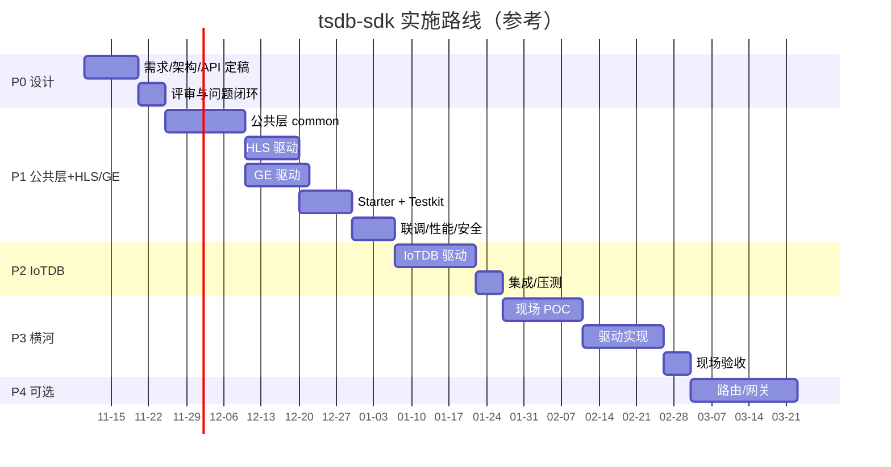

# 05 实施路线图与验收标准

> ⚠️ 范围变更（2026-11-09）：横河已移出本期范围，新增力控 pSpace；运行态改为“单活动实例 + 策略切换”。本文 P3 横河 POC 不再执行；调整后的路线图以 [`docs/06-范围变更与力控接入.md`](06-范围变更与力控接入.md) 第 7 节为准。

> 文档版本：v1.0（2026-11-09）  
> 目标：把设计拆成可执行阶段，明确每阶段交付物、验收标准、风险与下一步。  
> 关联：`docs/01`（需求）、`docs/02`（选型）、`docs/03`（架构）、`docs/04`（API）

---

## 1. 阶段总览

| 阶段 | 主题 | 周期（参考） | 关键产出 | 退出条件 |
|---|---|---|---|---|
| **P0** | 设计定稿 | 1–2 周 | 本套 5 份文档 | 评审通过、问题闭环、接口冻结 |
| **P1** | 公共层 + HLS/GE | 8–10 周 | `common`、`hls`、`ge`、`starter`、`testkit`、sample | 契约测试全绿、可切换 |
| **P2** | IoTDB 驱动 | 3–4 周 | `iotdb` 驱动 + 集成测试 | 写入/查询达标 |
| **P3** | 横河 POC + 驱动 | 4–6 周（依赖现场） | `yokogawa` 驱动 + POC 报告 | 现场 10 项验证通过 |
| **P4** | 路由/网关/运维增强 | 4 周（可选） | 标签路由、主备回退、gateway | 故障切换演练通过 |

> 周期按 2 名 Java 开发 + 1 名架构/评审 + 兼职测试估算；不含现场协调与审批等待。



---

## 2. P0：设计定稿（当前阶段）

### 2.1 已完成

- [x] 读取并解剖两套参照 SDK（HLS 43 文件/2926 行；GE 62 文件/8079 行）；
- [x] 抽取共同骨架与关键差异（认证、返回结构、质量码、时间、能力）；
- [x] 发现并记录参照实现缺陷（HLS MAX/MIN 写反、静态单例、默认无超时、fastjson 风险）；
- [x] 形成四库能力矩阵与选型初判（横河 DCS 直连 + IoTDB 汇聚）；
- [x] 输出需求、现状、架构、API、路线图五份文档。

### 2.2 待完成

| 编号 | 事项 | 产出 | 责任 |
|---|---|---|---|
| P0-1 | 文档评审 | 评审意见表 | 架构组/集成方 |
| P0-2 | 回答 Q1–Q10（见 `docs/01` 第 11 节） | 决策记录 | 业主/项目经理 |
| P0-3 | 横河 15 项现场问卷（见 `docs/02` 第 5.3 节） | 问卷回复 | 业主 DCS/横河 |
| P0-4 | 冻结模块/包名/artifactId/配置键 | 冻结清单 | 架构组 |
| P0-5 | 确认测试环境/账号/Mock 方案 | 环境清单 | 运维/集成方 |
| P0-6 | 安全评审（只读、TLS、密钥、审计） | 评审结论 | 安全/网络 |

### 2.3 退出标准

- 五份文档签字/邮件确认；
- Q1–Q10 有结论或明确“按默认执行”；
- 横河问卷已发出，POC 时间窗确定；
- 接口与配置键不再变更（除非评审否决）。

---

## 3. P1：公共层 + HLS/GE

### 3.1 工作包

| WBS | 工作包 | 内容 | 估算（人日） | 依赖 |
|---|---|---|---:|---|
| P1-01 | 工程脚手架 | parent/BOM/模块/编码/许可证/CI | 3 | P0 |
| P1-02 | 公共模型 | `TagInfo`/`Sample`/`TagSeries`/`HistoryQuery`/枚举 | 4 | P1-01 |
| P1-03 | 公共 API | `TsdbClient`/`TagCatalog`/`CurrentValueReader`/`HistoryReader`/`WriteSession` | 5 | P1-02 |
| P1-04 | 能力与异常 | `Capability`/`CapabilitySet`/异常体系/错误码 | 2 | P1-02 |
| P1-05 | 配置模型 | `TsdbProperties`/实例/认证/超时/重试/安全 | 4 | P1-02 |
| P1-06 | 公共运行时 | Manager/DriverRegistry/线程池/TokenManager/缓存/重试/熔断 | 10 | P1-03/04/05 |
| P1-07 | HLS 驱动 | 去静态客户端、Token、请求构造（修 MAX/MIN）、宽表拆分、标签缓存 | 10 | P1-06 |
| P1-08 | GE 驱动 | OAuth、数据/标签接口、长表解析、能力声明 | 12 | P1-06 |
| P1-09 | 原生 API | `HlsNativeApi`/`GeNativeApi`/unwrap | 3 | P1-07/08 |
| P1-10 | Starter | 自动装配、配置绑定、健康检查、指标 | 6 | P1-06 |
| P1-11 | Testkit | 契约测试基类、Mock Server、断言 | 8 | P1-03 |
| P1-12 | 示例 | HLS/GE 各 1 个可运行 sample | 4 | P1-10 |
| P1-13 | 文档 | API/配置/迁移/能力矩阵 | 5 | P1-10 |
| P1-14 | 联调/性能/安全 | 真实/Mock 联调、压测、依赖扫描 | 8 | P1-11/12 |
| | **合计** | | **84 人日** | |

> 2 人并行约 8–9 周；含缓冲按 10 周。

### 3.2 交付物

- `tsdb-sdk-common`、`tsdb-sdk-hls`、`tsdb-sdk-ge`、`tsdb-sdk-spring-boot-starter`、`tsdb-sdk-testkit`、`tsdb-sdk-samples`；
- 5 份文档更新（实现偏差回写）；
- 能力矩阵、迁移指南、配置参考；
- 测试报告（契约/性能/安全）。

### 3.3 验收标准

- [ ] 同一段示例代码仅改 `default-instance` 即可在 HLS/GE 间切换；
- [ ] HLS/GE 驱动通过 CT-01~CT-15 全部契约测试；
- [ ] 质量码、时间、类型归一抽样比对通过（每库 ≥20 个标签）；
- [ ] HLS MAX/MIN 聚合结果与厂商工具一致；
- [ ] 1000 标签实时读、24h 原始读达到 NFR-P1/P2（或给出厂商限制说明）；
- [ ] 断网/401/超时/token 过期四类故障测试通过；
- [ ] 默认只读、TLS 校验、密钥外置、写审计通过安全评审；
- [ ] 旧 `hls.datacollection`/`ge.datacollection` 配置可启动；
- [ ] `mvn verify` 全绿，依赖扫描无 high/critical。

---

## 4. P2：IoTDB 驱动

### 4.1 工作包

| WBS | 工作包 | 内容 | 估算（人日） |
|---|---|---|---:|
| P2-01 | 技术验证 | 版本/模型（树/表）、SessionPool 连通、SQL 语法 | 3 |
| P2-02 | 连接管理 | 多节点、会话池、重连、超时 | 4 |
| P2-03 | 标签目录 | `SHOW TIMESERIES`、元数据解析、分页 | 3 |
| P2-04 | 查询 | last/raw/aggregate/fill、时间精度转换 | 6 |
| P2-05 | 写入 | `insertRecords`/`insertTablet`、批量、失败定位 | 5 |
| P2-06 | 原生 API | `SessionPool` 暴露 | 1 |
| P2-07 | 测试 | 契约测试 + 集成 + 压测（10 万点） | 5 |
| | **合计** | | **27 人日** |

### 4.2 验收标准

- [ ] 单机/集群（如可用）连通；
- [ ] 原始/聚合/最新值/写入四类操作通过契约测试；
- [ ] 10 万点批量写入在目标时间内完成（现场定）；
- [ ] SQL 注入用例被拒绝；
- [ ] 会话泄漏/断线重连测试通过。

---

## 5. P3：横河 POC + 驱动

### 5.1 前置条件（硬门槛）

- [ ] 现场确认 OPC UA endpoint、SecurityPolicy、账号/证书；
- [ ] 确认是否支持 HDA；若不支持，切 ExaOPC HDA/Exaquantum；
- [ ] 网络放行（通常 4840）；
- [ ] 测试标签清单与对比工具；
- [ ] DCS 侧维护窗口。

### 5.2 工作包

| WBS | 工作包 | 内容 | 估算（人日） |
|---|---|---|---:|
| P3-01 | 现场 POC | 连接/Browse/实时/历史/断线/并发（10 项） | 10 |
| P3-02 | 驱动骨架 | Milo 客户端、证书、会话、重连 | 8 |
| P3-03 | 读实现 | Browse、Read、HistoryRead、聚合 | 10 |
| P3-04 | 归一 | NodeId→TagInfo、StatusCode→Quality、时间 | 5 |
| P3-05 | 原生 API | Milo 客户端暴露 | 1 |
| P3-06 | 测试/文档 | Mock OPC UA、契约、POC 报告 | 6 |
| | **合计** | | **40 人日** |

### 5.3 验收标准

- [ ] POC 10 项验证通过（见 `docs/02` 6.2）；
- [ ] 100 标签实时读延迟满足监盘要求；
- [ ] 24h 历史与 DCS 趋势一致；
- [ ] SignAndEncrypt 通过业主评审；
- [ ] 断线重连、DCS 负载正常；
- [ ] 输出限制清单（并发/会话/历史深度/许可）。

---

## 6. P4：路由/网关/运维增强（可选）

| 能力 | 内容 | 估算（人日） |
|---|---|---:|
| 标签路由 | 前缀/正则 → 实例；冲突检测 | 6 |
| 主备回退 | 超时/错误回退；来源标记 | 6 |
| REST 网关 | 查询/写入 API、鉴权、限流、审计 | 10 |
| 运维 | 配置热更新、指标面板、告警规则 | 6 |
| **合计** | | **28 人日** |

验收：故障切换演练（主库停机 30s，读请求回退成功率 ≥95%）；网关通过安全评审。

---

## 7. 测试策略

### 7.1 测试金字塔

```
        ┌──────────────┐
        │ 现场验收/POC  │  少、慢、真实
        ├──────────────┤
        │ 集成测试      │  Mock/真实实例
        ├──────────────┤
        │ 契约测试      │  每驱动同一套
        ├──────────────┤
        │ 单元测试      │  多、快
        └──────────────┘
```

### 7.2 单元测试

- 模型校验、配置绑定、质量映射、时间转换、宽表拆分、SQL 构造；
- 覆盖率目标：common ≥ 80%，驱动核心映射 ≥ 70%。

### 7.3 契约测试（testkit）

统一用例 CT-01~CT-15（见 `docs/04` 第 12 节）。每个驱动继承同一基类，只提供：
- 驱动工厂；
- Mock/真实服务；
- 期望的能力集合。

### 7.4 集成测试

- HLS/GE：Mock Server（WireMock）覆盖正常/401/500/超时/畸形响应；
- IoTDB：Testcontainers 或现场实例；
- 横河：Milo 测试服务器 + 现场 POC。

### 7.5 性能测试

| 场景 | 指标 |
|---|---|
| 1000 标签实时读 | p95、吞吐、错误率 |
| 单标签 24h 原始点 | p95、内存 |
| 8 并发混合查询 | p95、CPU、线程池 |
| 10 万点写入（IoTDB） | 吞吐、失败率 |

### 7.6 安全测试

- 凭证泄露扫描（日志/异常/配置）；
- TLS 握手失败/自签/主机名不匹配；
- 401/403 行为；
- SQL 注入（IoTDB）；
- 依赖漏洞（OWASP dependency-check）；
- 写门禁绕过测试。

### 7.7 混沌测试

- 断网 30s、DNS 失败、连接重置；
- token 过期/被吊销；
- 厂商 500/429/畸形 JSON；
- 线程池满、队列满；
- 关闭时在途请求。

---

## 8. 资源与估算

| 角色 | 投入 | 职责 |
|---|---|---|
| 架构/技术负责人 | 50% | 设计、评审、关键实现 |
| Java 开发 A | 100% | common + HLS + starter |
| Java 开发 B | 100% | GE + IoTDB + 横河 |
| 测试/QA | 50% | 契约/集成/性能/安全 |
| 现场/运维 | 按需 | 环境、网络、账号、POC |
| 安全/网络 | 按需 | 评审、放行 |

**总工作量（P1–P3）**：约 151 人日；2 名开发并行约 4–5 个月（含现场等待）。

---

## 9. 风险与应对

| 风险 | 概率 | 影响 | 应对 | 触发信号 |
|---|---|---|---|---|
| 横河 OPC UA/HDA 能力与预期不符 | 中 | 高 | POC 先行；备选 ExaOPC/Exaquantum | POC Y1/Y4 失败 |
| 现场不允许直连 DCS | 高 | 高 | 网关模式；只读跳板 | 网络评审否决 |
| 许可未购买 | 中 | 高 | P0 阶段确认 | 采购延迟 |
| HLS 能力不足被业务方质疑 | 高 | 中 | 能力矩阵 + 降级方案 | 需求评审 |
| 静态单例改造回归 | 中 | 中 | 契约测试 + 双跑对比 | 联调差异 |
| fastjson 依赖被卡 | 中 | 高 | 1.2.83 + AutoType 关闭 + safeMode；必要时回退 fastjson2 2.0.51 | 安全扫描 |
| 现场 JDK 8 限制 | 中 | 中 | Java 8 基线 | 编译失败 |
| 时区/DST 数据错位 | 中 | 中 | Instant + 时区测试 | 抽样不一致 |
| 标签量过大 OOM | 中 | 中 | 分页/流式/上限 | 压测 |
| 关键人离职 | 低 | 高 | 文档/结对/代码评审 | — |

---

## 10. 需求追踪矩阵

| 需求 | 模块 | 阶段 | 验证 |
|---|---|---|---|
| FR-01 统一客户端 | common | P1 | CT-01/13 |
| FR-02 配置驱动 | starter | P1 | 配置测试/示例 |
| FR-03 独立驱动 | 各驱动 | P1/P2/P3 | 依赖检查 |
| FR-04 原生 API | 各驱动 | P1/P2/P3 | CT-14 |
| FR-05 标签目录 | common+驱动 | P1 | CT-03 |
| FR-06 实时值 | common+驱动 | P1 | CT-04/05 |
| FR-07 原始历史 | common+驱动 | P1/P2/P3 | CT-06 |
| FR-08 聚合历史 | common+驱动 | P1 | CT-07 |
| FR-09 插值/采样 | common+驱动 | P1/P2 | CT-07 |
| FR-10 写入 | common+驱动 | P1/P2 | CT-15 |
| FR-11 能力协商 | common | P1 | CT-02/11 |
| FR-12 模型归一 | common | P1 | CT-08 |
| FR-13 错误模型 | common | P1 | CT-09/10 |
| FR-14 健康/指标 | starter | P1 | 健康测试 |
| FR-15 旧配置兼容 | starter | P1 | 迁移测试 |
| FR-16 横河 | yokogawa | P3 | POC |
| FR-17 IoTDB | iotdb | P2 | 集成测试 |
| FR-18 安全 | common+starter | P1 | 安全测试 |
| FR-19 路由 | common | P4 | 切换演练 |
| FR-20 文档/示例 | all | P1 | 示例可运行 |

---

## 11. 完成定义（DoD）

一个功能“完成”必须同时满足：

- [ ] 代码实现 + 单元测试；
- [ ] 契约测试通过（如适用）；
- [ ] 文档更新（API/配置/能力矩阵）；
- [ ] 示例或迁移说明；
- [ ] 代码评审通过；
- [ ] 无 high/critical 依赖漏洞；
- [ ] 日志不含敏感信息；
- [ ] 错误信息含实例/操作/厂商码。

---

## 12. 下一步（未来 2 周）

| 序号 | 动作 | 产出 | 责任 | 截止 |
|---|---|---|---|---|
| 1 | 评审 5 份文档 | 评审意见 | 架构组 | D+3 |
| 2 | 回答 Q1–Q10 | 决策记录 | 业主/项目经理 | D+5 |
| 3 | 发出横河问卷 | 问卷回复 | 业主 DCS | D+7 |
| 4 | 冻结模块/包/配置键 | 冻结清单 v1.0 | 架构组 | D+5 |
| 5 | 搭 P1 脚手架 | parent/BOM/common 空实现 | 开发 A | D+10 |
| 6 | 准备 HLS/GE 测试环境 | 账号/网络/Mock | 运维 | D+10 |
| 7 | 安全预评审 | 只读/TLS/密钥方案 | 安全 | D+10 |

### 12.1 建议的第一个冲刺（Sprint 1）

- 工程脚手架 + `common` 模型/接口/异常/能力；
- HLS 驱动骨架（去静态 + token + 标签 + 实时值）；
- WireMock 契约测试基类；
- 1 个 HLS 示例。

**Sprint 1 演示**：用统一 API 读取 HLS 实时值，并展示 `capabilities()` 与原生 `unwrap`。

---

## 13. 待确认问题（与 `docs/01` 第 11 节同步）

> 这些问题不阻塞文档评审，但阻塞 P1 编码与 P3 现场。

1. JDK 基线（8/17）？
2. 发布方式（私服/Central/源码）？
3. 横河具体产品/版本？
4. 横河是否支持 OPC UA HDA？
5. IoTDB 版本/模型/角色？
6. 是否允许写 DCS/historian？
7. 切换粒度（默认实例/标签路由）？
8. 是否要求旧 SDK 二进制兼容？
9. 网络分区/代理策略？
10. 许可证是否允许分发？

---

## 14. 本章结论

1. **先 P0 闭环，再写代码**：横河的不确定性必须在 POC 前暴露，不能带进大规模实现。
2. **P1 是成败关键**：公共层与 HLS/GE 收口验证了“能力协商 + 多实例 + 原生逃生口”三件事，后面两个驱动只是复制骨架。
3. **IoTDB 先于横河**：它可本地验证、风险低，能提前暴露公共层的扩展性问题。
4. **横河以 POC 为门槛**：10 项验证不过，不进入生产实现，避免“写完才发现协议不支持”。
5. **验收以契约测试为准**：没有通过的用例，不算“支持”。
